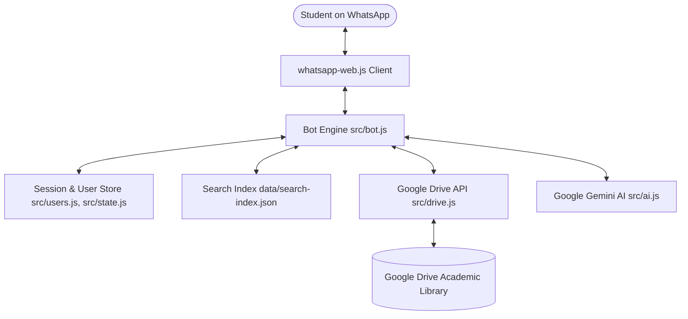

# Drive WhatsApp Bot 📚🤖

An intelligent, AI-powered WhatsApp bot that transforms Google Drive academic repositories into an interactive digital library and study assistant. Built with **Node.js**, **whatsapp-web.js**, **Google Drive API**, and **Google Gemini AI**.

Students can discover lecture notes, past questions, and textbooks through natural language conversation, download files directly to WhatsApp, and ask AI-powered study questions answered straight from the course documents.

---

## ✨ Features

- 🧠 **AI-Powered Semantic Search**: Understands conversational student queries (e.g., *"Send 2nd MBBS biochemistry past questions"* or *"I need anatomy notes for first semester"*).
- 📖 **In-Chat Study Assistant**:
  - Explains concepts, summarizes lectures, and generates quiz/exam questions using Google Gemini.
  - Pulls context directly from the actual documents in Google Drive.
- 📂 **Google Drive Tree Indexing**:
  - Automatically crawls and recursively maps folder hierarchies from configured Google Drive root folders.
  - Caches index locally on disk for fast search retrieval with periodic background re-indexing.
- 📥 **Direct Document Delivery**:
  - Sends PDF, DOCX, PPTX, and other study materials directly to the student in chat as documents.
  - Automatically exports Google Docs and Sheets to PDF format.
- 🧭 **Interactive Directory Browsing**:
  - Browse folders interactively using commands like `home`, `browse`, and `back`.
  - Numbered selection (`1`, `2`, `3`) or natural language commands (*"send the first one"*, *"open 2"*).
- 📊 **Admin Analytics & Management**:
  - Real-time statistics: Total users, daily/weekly/monthly active users, message counts, and total downloads.
  - Rate-limited broadcast messaging system to send announcements to all users safely.

---

## 🏗️ Architecture



---

## 📁 Project Structure

```text
drive-whatsapp-bot/
├── src/
│   ├── bot.js          # Core WhatsApp bot controller, command handlers, and events
│   ├── drive.js        # Google Drive API client, folder crawler, and file downloader
│   ├── ai.js           # Gemini AI integration for academic queries and study notes
│   ├── state.js        # In-memory user session and browsing state
│   └── users.js        # User activity persistence and usage analytics
├── data/               # Persistent data (search index, user analytics)
├── downloads/          # Temporary staging directory for downloaded files
├── .env.example        # Environment variable template
├── .gitignore          # Git exclusion rules
├── package.json        # Dependencies and scripts
└── README.md           # Documentation
```

---

## 🚀 Getting Started

### Prerequisites

- **Node.js**: v18.x or v20.x or later.
- **WhatsApp Account**: A dedicated phone number or personal number for the bot.
- **Google Cloud Platform Project**:
  - Google Drive API enabled.
  - A Service Account key (`service-account.json`).
  - Google Drive folders shared with the Service Account email (`Viewer` or `Editor` permissions).
- **Google Gemini API Key**: Obtainable from [Google AI Studio](https://aistudio.google.com/).

---

### 1. Installation

Clone the repository and install dependencies:

```bash
git clone <YOUR_REPOSITORY_URL>
cd drive-whatsapp-bot
npm install
```

---

### 2. Google Drive Service Account Setup

1. Go to the [Google Cloud Console](https://console.cloud.google.com/).
2. Create a project and enable the **Google Drive API**.
3. Create a **Service Account** under **IAM & Admin > Service Accounts**.
4. Generate and download a JSON key. Save it in the project root as:
   ```text
   service-account.json
   ```
5. Open your Google Drive in a browser, navigate to the study material root folders, and **Share** each folder with the service account email (found in `client_email` of the JSON file).
6. Copy the folder IDs from the Google Drive URL (the long string after `/folders/`):
   ```text
   https://drive.google.com/drive/folders/17uvkGoNWJekQJtY... -> 17uvkGoNWJekQJtY...
   ```

---

### 3. Environment Configuration

Copy the sample environment file:

```bash
cp .env.example .env
```

Edit `.env` with your specific values:

```env
# Path to your Google Service Account key
GOOGLE_SERVICE_ACCOUNT_JSON=./service-account.json

# Comma-separated list of Google Drive Root Folder IDs
ROOT_FOLDER_IDS=folder_id_1,folder_id_2

# Bot Information
BOT_NAME=Academic Materials Assistant
COMMUNITY_NAME=NextGen Hub
COMMUNITY_LINK=https://chat.whatsapp.com/your-invite-link

# Owner / Admin Configuration (international format without + or spaces)
OWNER_NUMBER=2348123456789
OWNER_CHAT_ID=

# AI Configuration
GEMINI_API_KEY=AIzaSy...
GEMINI_MODEL=gemini-2.5-flash
GEMINI_STUDY_MODEL=gemini-2.5-flash

# Operational Parameters
MAX_FILE_MB=90
PAGE_SIZE=40
INDEX_REFRESH_MINUTES=10
BROADCAST_DELAY_MS=1500
AI_CANDIDATE_LIMIT=12
AI_STUDY_FILE_LIMIT=2
AI_SOURCE_FILE_MAX_MB=18
```

---

### 4. Running the Bot

Start the application:

```bash
npm start
```

1. On initial startup, a **QR code** will display in the terminal.
2. Open WhatsApp on your phone > **Linked Devices** > **Link a Device**.
3. Scan the terminal QR code.
4. The bot will authenticate, save session data to `.wwebjs_auth/`, and begin building the Google Drive search index.

---

## 💬 Usage & Commands

### Student Commands

| Input / Query | Action |
|---|---|
| `home` / `start` / `menu` | Return to top-level Google Drive folders |
| `browse` | View contents of the current folder |
| `back` | Navigate one folder level up |
| `search <query>` | Direct keyword search across the library |
| `<number>` (e.g., `1`, `2`) | Open folder or download document from the last results |
| *Natural Language* | E.g., *"Do you have any past questions for anatomy 200 level?"* |
| *Study Queries* | E.g., *"Explain the steps of Krebs cycle from the biochemistry material"* or *"Quiz me on anatomy"* |
| `help` | Display general commands and assistance |

---

### Owner / Admin Commands

> Available only to the number configured under `OWNER_NUMBER` or `OWNER_CHAT_ID`.

- **`stats`** / **`analytics`**: View usage metrics:
  - Total registered users
  - Daily, weekly, and monthly active users
  - Total messages handled
  - Total file downloads delivered
- **`broadcast <message>`**: Send an announcement message to all users who have interacted with the bot. Messages are safely spaced by `BROADCAST_DELAY_MS` to prevent WhatsApp spam triggers.

---

## ⚙️ Configuration Parameters

| Variable | Default | Description |
|---|---|---|
| `GOOGLE_SERVICE_ACCOUNT_JSON` | `./service-account.json` | Path to Google Service Account JSON key |
| `ROOT_FOLDER_IDS` | *(Required)* | Comma-delimited list of Google Drive parent folder IDs |
| `MAX_FILE_MB` | `90` | Maximum file size (in MB) allowed to be sent via WhatsApp |
| `INDEX_REFRESH_MINUTES` | `10` | Interval between automatic background Drive re-crawls |
| `BROADCAST_DELAY_MS` | `1500` | Delay between consecutive broadcast messages (ms) |
| `GEMINI_API_KEY` | *(Optional)* | Google Gemini API key for smart intent detection & study tutoring |
| `GEMINI_MODEL` | `gemini-2.5-flash` | Gemini model used for query parsing and response generation |
| `AI_SOURCE_FILE_MAX_MB` | `18` | Max document file size passed into Gemini context for study questions |

---

## 🛡️ Production Deployment (PM2)

For persistent background execution on a VPS or cloud server:

```bash
# Install PM2 globally
npm install -g pm2

# Start the bot under PM2
pm2 start src/bot.js --name "drive-whatsapp-bot"

# Enable auto-restart on system reboot
pm2 startup
pm2 save
```

---

## 🔒 Security Best Practices

- **Never commit `.env` or `*.json` credential files** (`service-account.json`, `client_secret*.json`) to GitHub or public repositories.
- The `.gitignore` provided in this repository is pre-configured to exclude all credentials, auth session folders (`.wwebjs_auth`, `.wwebjs_cache`), and internal data stores.

---

## 📄 License

This project is licensed under the [ISC License](LICENSE).
